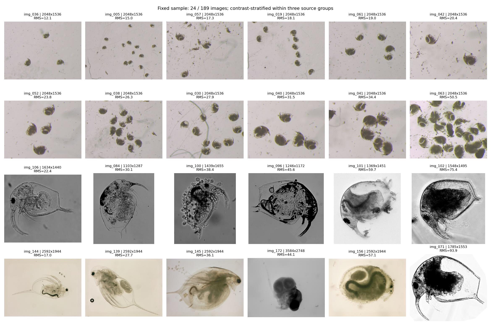

# Детекция и сегментация планктона без разметки

Сравнение **RetinaNet ResNet-50/FPN v2** и **Faster R-CNN ResNet-50/FPN v2**,
влияния аугментаций, а также **GrabCut** и **SAM 2.1 Hiera Tiny** с одинаковыми
bounding boxes. Используются только предобученные модели, без дообучения.

**Основной результат:** RetinaNet — 72 рамки и 59,33 мс на исходный снимок,
Faster R-CNN — 96 рамок и 112,11 мс. На 22 одинаковых основных рамках GrabCut
занял 2455,87 мс, SAM 2.1 — 115,75 мс (медианы). Визуально обнаружены пропуски,
фоновые рамки и ошибки выбора объекта. RetinaNet выбран как более быстрый
источник предложений; SAM удобнее для первичных масок с проверкой человеком.
Большее число рамок и confidence не означают большую точность.

## Просмотр выполненной работы

Репозиторий сдачи: [laughingcat72/DZ3](https://github.com/laughingcat72/DZ3).
Проверка каждого требования: [ASSIGNMENT_CHECKLIST.md](ASSIGNMENT_CHECKLIST.md).

- `plankton_experiments.ipynb` — полный код, пояснения и сохранённые выводы ячеек.
- `plankton_experiments.html` — тот же выполненный Notebook для открытия в браузере.
- `REPORT.md` — анализ чисел, конкретных ошибок и итоговые выводы.
- `results/tables/detection_four_groups.csv` — четыре группы детекции.
- `results/tables/segmentation_summary.csv` — сравнение сегментации.
- `results/` — рамки, маски, иллюстрации и структурированные предсказания.

В GitHub полный набор изображений и масок сохранён в **`results_archives/*.zip`**,
чтобы не разносить сотни бинарных файлов по дереву репозитория. Это независимые
обычные ZIP-архивы; все они извлекаются одной командой `python scripts/unpack_results.py`.
Notebook с сохранёнными выводами и HTML уже содержат иллюстрации. При выполнении
ячеек в режиме просмотра Notebook сам распаковывает локальные архивы без загрузки
моделей и без инференса. CSV/JSON доступны непосредственно; все графики встроены
в Notebook и HTML, а их отдельные файлы находятся в архивах.



Вычислительно затратные модели **не нужно запускать**, чтобы просмотреть
сохранённый Notebook, HTML, CSV/JSON и изображения. Все числа получены реальным
локальным запуском; в отчёте отдельно оговорены ограничения сравнения без разметки.

## Данные и схема эксперимента

Инвентаризация: 189 изображений. Фиксированная выборка: 24 изображения,
стратифицированные по контрасту внутри трёх групп источников, до инференса.
Для обеих моделей используются **те же** снимки и варианты. Схема четырёх групп:
2 детектора × {оригинал, аугментации}. В каждой модели 24 оригинала и
24×12=288 преобразованных снимков; всего **624 пары**, по три замера времени.

Аугментации: яркость ×1.15/1.35; контраст ×0.8/0.5; шум σ=5/20;
размытие σ=0.8/2; гамма 0.7/1.5; отражение; поворот 90°.
Изображения уменьшаются с сохранением пропорций до длинной стороны ≤1024.
Детекторы используют одинаковый внутренний resize 640/1024, score≥0.25,
NMS=0.5; сохраняются также кандидаты ≥0.05 и чувствительность к порогам 0.10/0.50.

Устойчивость считается после обратного преобразования рамок в исходную систему
координат, с взаимно однозначным class-agnostic сопоставлением при IoU≥0.5.
Это **не точность**: правильность не установлена эталонной разметкой.
COCO-классы, включая `cake`, `bird` и `apple`, не означают биологические виды.
Названия исходных файлов с `obj/class/conf` не используются как аннотации.

Сегментация использует не более двух наиболее уверенных рамок Faster R-CNN
на каждом втором снимке выборки. Дополнительно проверяются тесные и широкие
рамки. Оба метода получают одинаковые целочисленные box prompts.
Всего 28 пар масок: 22 основных, 4 проверки размера рамки и 2 отдельно отмеченных
случая перекрытия, выбранных после визуального просмотра. Ручных рамок нет.
SAM 2.1 работает без CUDA-постобработки и без обучения; время включает encoder
для каждого запроса, а также отдельно приведены encoder/decoder. GrabCut:
пять итераций на CPU. Все рамки и происхождение подсказок сохранены.

## Полный повторный запуск

Проверено: Python **3.12.13**, Windows 11, NVIDIA GeForce RTX 3060 Laptop GPU
(6 ГБ), PyTorch **2.6.0+cu124**, Torchvision **0.21.0+cu124**. Детекторы и SAM
используют FP32. CPU-запуск поддержан выбором устройства, но будет медленнее.
Meta рекомендует Linux/WSL; здесь проверена установка Windows без CUDA-расширения SAM.

Из корня репозитория создайте отдельное окружение. Для Windows PowerShell:

```powershell
py -3.12 -m venv .venv
.\.venv\Scripts\Activate.ps1
python -m pip install --upgrade pip setuptools wheel
python -m pip install torch==2.6.0 torchvision==0.21.0 --index-url https://download.pytorch.org/whl/cu124
python -m pip install -r requirements.txt
$env:SAM2_BUILD_CUDA = "0"
python -m pip install --no-build-isolation --no-deps "git+https://github.com/facebookresearch/sam2.git@2b90b9f5ceec907a1c18123530e92e794ad901a4"
```

Для CPU используйте индекс `https://download.pytorch.org/whl/cpu` в строке
установки PyTorch. На Linux/macOS создайте окружение через `python3.12 -m venv`,
активируйте `source .venv/bin/activate` и задайте `export SAM2_BUILD_CUDA=0`.
Git должен быть установлен для загрузки исходного кода SAM.
`requirements-lock.txt` фиксирует полное окружение выполненного Windows-запуска;
основной переносимый набор прямых зависимостей находится в `requirements.txt`.

Получите учебный архив по ссылке преподавателя в `DATA_POLICY.md` или используйте
предоставленный ZIP. Полный исходный набор в Git не включён.

```powershell
python scripts/import_data.py --zip "ПУТЬ_К_УЧЕБНОМУ_АРХИВУ.zip" --output data
python scripts/download_weights.py --output checkpoints
python -m unittest discover -s tests -v
python scripts/run_all.py --data data --checkpoints checkpoints
```

После пересчёта откройте Notebook и выполните ячейки при `RUN_EXPERIMENTS=False`,
чтобы обновить встроенные результаты без повторного инференса. Для пересчёта
прямо из Notebook задайте `RUN_EXPERIMENTS=True`. При другом расположении данных
доступны `PLANKTON_DATA_DIR` и `PLANKTON_SAM_CHECKPOINT`.

HTML можно пересоздать:

```powershell
python -m nbconvert --to html plankton_experiments.ipynb
```

## Организация результатов

```text
src/experiment.py             анализ, аугментации, детекторы, сопоставление рамок
src/segmentation.py           GrabCut, SAM 2.1, одинаковые подсказки
scripts/                     импорт, скачивание весов, запуск, сборка Notebook
tests/test_geometry.py       повороты, отражение, пустые/повторяющиеся детекции
results/tables/              все замеры, инвентаризация, выборка, сводные таблицы
results/predictions_*.json   score, COCO-метка, рамки в трёх системах координат
results/segmentation_prompts.json  точное происхождение и координаты подсказок
results/masks/               отдельные бинарные PNG 0/255, включая native-size
results/detections/          визуализации всех пар модель–снимок–вариант
results/segmentation/        маски и наложения обоих методов
results/figures/             обзор данных, аугментации, сравнительные графики
results/environment.json     реальные версии, оборудование, протокол времени
results/weights_manifest.json SHA256 предобученных весов
```

В JSON `box_aug` — рамка на преобразованном рабочем снимке, `box_base` —
после обратного геометрического преобразования, `box_original` — на исходном
снимке после учёта EXIF-ориентации. Формат везде `[x1,y1,x2,y2]`, пиксельные
координаты краёв. В масках `*_native.png` применяется nearest-neighbor resize;
новые детали при увеличении не восстанавливаются.

Медиана трёх повторов является единицей сравнения времени. В CSV сохранены
все повторы детекции. Модельная загрузка, чтение изображений, аугментации и
рисование не входят в инференс. CUDA синхронизируется до и после замера.
Число детекций, confidence и согласие двух масок не трактуются как accuracy.

## Источники

[RetinaNet / Focal Loss](https://arxiv.org/abs/1708.02002),
[Faster R-CNN](https://arxiv.org/abs/1506.01497),
[Torchvision](https://docs.pytorch.org/vision/0.21/models.html),
[GrabCut / OpenCV](https://docs.opencv.org/4.x/d8/d83/tutorial_py_grabcut.html),
[SAM 2](https://arxiv.org/abs/2408.00714),
[код Meta](https://github.com/facebookresearch/sam2),
[веса SAM 2.1 Tiny](https://huggingface.co/facebook/sam2.1-hiera-tiny).
